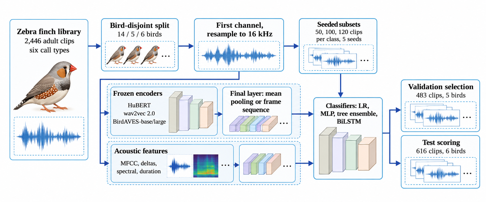
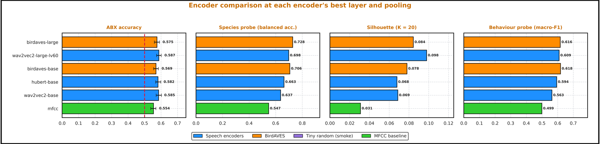
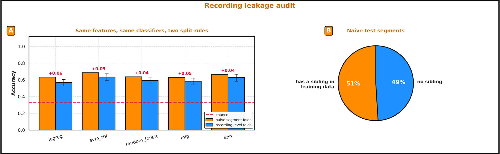

# BioLingua: Self-Supervised Representations of Bird Vocalizations

**Do speech-pretrained or bird-pretrained audio encoders capture the structure of bird calls, and how much of a reported score survives a split that keeps individual birds and recordings out of training?**


<p align="center">
  
</p>

BioLingua is a research codebase for bioacoustic representation learning. It contains two studies that share one evaluation toolkit:

1. **Zebra finch call-type benchmark** (`notebooks/zf_layer_sweep_and_test.ipynb`): a controlled, bird-disjoint comparison of four frozen encoders under matched label budgets and matched classifier heads.
2. **Multi-species pipeline** (`notebooks/biolingua_full_pipeline.ipynb`): a Xeno-Canto pipeline covering encoder benchmarking, acoustic-unit discovery, sequence language models, ABX discrimination, behaviour probes and a recording-leakage audit.

## Study 1: Zebra finch call classification with frozen encoders

**Question.** BirdAVES appears to outperform speech-pretrained HuBERT. Does that advantage hold once the label budget and the downstream classifier are the same for every encoder?

**Protocol.**
- 2,446 cleaned adult recordings from 25 birds, six call types ([Elie & Theunissen zebra finch library](https://doi.org/10.6084/m9.figshare.11905533)).
- Split by **bird identity**: 14 / 5 / 6 birds → 1,347 train / 483 val / 616 test clips. No bird appears in two splits, and the code stops if one does.
- Encoders (all frozen, with pinned checkpoints and SHA-256-verified weights): **HuBERT**, **wav2vec 2.0**, **BirdAVES-base**, **BirdAVES-large**.
- Five seeded, nested, class-balanced training subsets (50 / 100 / 120 clips per class).
- Heads: logistic regression, MLP and XGBoost on pooled vectors, plus a BiLSTM on frame sequences.
- 240 validation-selected runs. The test split is touched only once, after selection.

**Result (test macro-F1, BiLSTM, 120 clips/class, mean over 5 seeds):**

| Encoder | Pretraining domain | Test macro-F1 |
|---|---|---|
| **BirdAVES-base** | animal / bird audio | **0.714** (SD 0.015) |
| BirdAVES-large | animal / bird audio | 0.659 |
| HuBERT | human speech | 0.555 |
| wav2vec 2.0 | human speech | 0.402 |

The layer-sweep notebook adds two analyses. It scores every transformer layer of each encoder on validation birds only, then re-runs the full test with clip-level predictions and bird-level uncertainty.

> **Scope of the claim.** The test set has six held-out birds, so the seed SD does not measure population-level generalisation. Encoders differ in architecture as well as pretraining data, so the ranking is conditional on this protocol and is not causal evidence about the pretraining domain.

## Study 2: Multi-species pipeline (Xeno-Canto)

**Question.** Can the building blocks of bird sound (acoustic units) be learned from raw audio without labels, modelled as sequences, and shown to carry information about species and behaviour (alarm, song, contact)?

Corpus (standard preset): 1,258 recordings from 5 European species (*Corvus corone, Erithacus rubecula, Fringilla coelebs, Parus major, Turdus merula*), giving 26,053 three-second segments. Behaviour labels are weak labels taken from uploader call-type text.

<p align="center">
  
</p>

- **Encoder benchmark.** We swept HuBERT, wav2vec2 (base and large) and BirdAVES (base and large) across layers and pooling types, scoring each with ABX, a species probe, clustering and a behaviour probe. BirdAVES-large had the best species probe (balanced accuracy 0.728, against 0.547 for the MFCC baseline).
- **Recording-leakage audit.** We ran the same features and classifiers twice, once with naive segment-level folds and once with recording-level folds. The naive split inflates accuracy by **4–6 points** for every classifier, because 51 % of naive test segments have a sibling segment from the same recording in training. All headline numbers use recording-level splits.

<p align="center">
  
</p>

The pipeline also covers a contrastive projection adapter, acoustic-unit discovery (K-Means, GMM, HDBSCAN, Ward and a VQ autoencoder), n-gram and neural sequence models with shuffle controls, a 20-experiment ablation suite with multiple-comparison correction, and a data-scaling study. All result tables are in [`results/tables/`](results/tables).

## Repository layout

```
biolingua/
├── notebooks/
│   ├── zf_layer_sweep_and_test.ipynb     # Study 1: layer sweep + final held-out test
│   └── biolingua_full_pipeline.ipynb     # Study 2: full multi-species pipeline (17 parts)
├── figures/                              # Selected figures (downscaled; originals are 900 DPI)
└── results/tables/                       # All result tables as CSV
```

## Reproducing

The notebooks are designed for **Kaggle** (GPU T4 ×2 or P100, Internet on).

1. Upload the notebook to Kaggle.
2. For Study 2, add a Kaggle Secret named `XENO_CANTO_API_KEY`. The key is read from Secrets or an environment variable and is never written into the notebook.
3. Pick a preset in the configuration cell and run all cells:

| Preset | Data | Purpose | Approx. time (T4) |
|---|---|---|---|
| `smoke` | Synthetic audio, tiny random encoders | Checks that every cell runs | 5–15 min |
| `pilot` | 5 species × 60 recordings | Quick real run | 1–2 h |
| `standard` | 5 species × ~260 recordings | Numbers reported above | several hours |

Every figure is saved as a 900 DPI PNG and a vector PDF. Every table is saved as CSV and LaTeX. Outputs have been cleared from the committed notebooks to keep the repository light.

## Data

Datasets are **not redistributed** here.
- Zebra finch vocalization library: Elie, J. E. & Theunissen, F. E., [doi:10.6084/m9.figshare.11905533](https://doi.org/10.6084/m9.figshare.11905533)
- Xeno-Canto recordings: <https://xeno-canto.org> (each recording carries its own Creative Commons license)

## Authors

Muhammad Adnan (SEECS, NUST), in collaboration with Ayaan Aatif. The manuscript is in preparation, and citation details will be added on publication.

## License

Code is released under the [MIT License](LICENSE).
